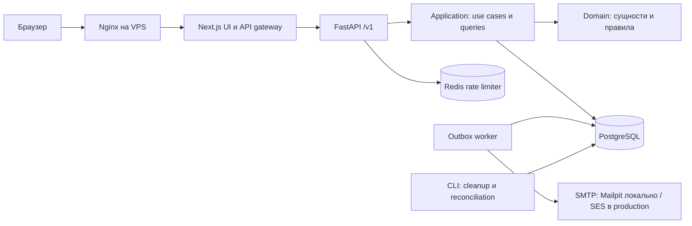

# Архитектура FinCore

Срез реализации: **15 ноября 2026**. Документ описывает код в репозитории. [PRD MVP v1.0](../FinCore_PRD_MVP_v1.0%20%281%29.pdf) и [изменение scope](scope-update-2026-10-16.md) остаются историческими источниками требований.

## Компоненты и слои

Backend — модульный монолит. `domain` содержит сущности, value objects и инварианты без зависимости от FastAPI или SQLAlchemy. `application` содержит команды, use cases, queries, DTO и интерфейсы. `infrastructure` реализует SQLAlchemy repositories/readers, Redis limiter, криптографию, SMTP и настройки. `presentation` отвечает за HTTP, валидацию, авторизацию, DI, обработку ошибок и RU/EN OpenAPI. `bootstrap` предоставляет точки запуска API, worker и служебных CLI.

`SqlAlchemyUnitOfWork` получает фабрику сессий, создаёт сессию при входе и закрывает её при выходе. Незавершённая транзакция откатывается даже при обычном возврате из use case. Изменяющий use case явно вызывает один `commit`; repositories самостоятельно не коммитят. Read queries используют отдельные reader-интерфейсы и DTO без изменения сущностей.

Основные модули: auth/users/sessions, verification, wallets/balances, transfers, sandbox top-ups, ledger, idempotency, outbox и reconciliation. [API](api.md) и [модель данных](data-model.md) описывают фактические контракты.

## Денежная транзакция

`CreateTransferUseCase` проверяет формат команды, существование и активность пользователя, затем резервирует ключ идемпотентности. Завершённый повтор возвращает прежний `transfer_id`; другой payload с тем же ключом отклоняется.

Для нового перевода порядок блокировок: пользователь, затем кошельки по возрастанию UUID, затем соответствующие balances и ledger accounts. Под блокировками проверяются владение отправителем, активность обоих кошельков и счетов, совпадение валют, предел суммы, достаточность средств и отсутствие переполнения. Transfer, journal, две проводки, обновления проекций и результат идемпотентности сохраняются одной транзакцией.

Для перевода между liability accounts debit уменьшает обязательство перед отправителем, credit увеличивает обязательство перед получателем. Sandbox top-up создаёт debit системного asset account и credit liability account кошелька. Sandbox требует настройки `SANDBOX_ENABLED` и серверного разрешения в `sandbox_operators`.

PostgreSQL — источник финансовой истины. `wallet_balances` — синхронная проекция ledger. Redis участвует только в ограничении запросов. БД дополнительно проверяет валютные FK, баланс journal и соответствие исходной операции через deferred triggers; проведённые операции и проводки защищены от UPDATE/DELETE/TRUNCATE. Read-only `ReconcileLedgerQuery` и CLI `backend.bootstrap.reconcile_ledger` ищут расхождения, автоматически данные не исправляют.

## Авторизация и письма

Регистрация создаёт пользователя `pending_confirmation`, challenge и outbox message в одной транзакции. Пароль задаётся при подтверждении. Повторная отправка `/v1/auth/confirm/resend` аннулирует предыдущие регистрационные challenges под блокировкой пользователя и создаёт новое письмо; допустимые запросы получают одинаковый ответ 202 независимо от наличия подходящего аккаунта.

Пароли хэшируются Argon2id. Access token — JWT с ограниченным TTL; refresh — непрозрачный секрет, в БД хранится его hash. Refresh ротируется, повтор использованного токена отзывает сессию. Смена и восстановление пароля отзывают сессии. При подтверждении восстановления backend генерирует новый пароль и возвращает его один раз в ответе; отдельное уведомление сообщает об изменении пароля.

Отзыв сессии блокирует её refresh; уже выданный access JWT проверяется без привязки к session ID и остаётся действительным до истечения TTL при активном пользователе.

Outbox worker читает сообщения с lease и `SKIP LOCKED`, отправляет через SMTP с ограниченными повторами. Доставка допускает повтор письма при сбое после SMTP-отправки. При terminal status (`sent`, `failed`, `expired`) секретный payload очищается. Локально используется Mailpit, в production — SMTP endpoint Amazon SES.

## Frontend и доверенный IP

Next.js App Router использует реальный backend через allowlist gateway `/api/backend/*`. Gateway хранит access/refresh в HttpOnly SameSite=Lax cookies, Secure в production, и добавляет Bearer при обращении к API. Токены не возвращаются клиентскому JavaScript. Изменяющие запросы проходят проверку Origin; адрес backend и proxy secret — server-only настройки.

Production-цепочка: Nginx перезаписывает `X-Fincore-Proxy-Token` независимым серверным секретом и `X-Real-IP` одним адресом клиента. Gateway проверяет секрет и адрес, использует `PUBLIC_APP_ORIGIN` для проверки Origin, затем отправляет API собственные `X-Forwarded-For`/`X-Forwarded-Proto`. Uvicorn доверяет только закреплённому IP frontend в отдельной Docker gateway network. FastAPI в production Compose не публикуется на хост. Nginx-конфигурация остаётся задачей владельца VPS; договорённость приведена в [deployment](deployment.md).

Без настроенной production proxy-цепочки gateway отклоняет запросы. В локальном development без proxy secret forwarded headers игнорируются, а API видит loopback. IP и user-agent используются в сессиях и rate limits; user-agent остаётся информацией, заявленной клиентом.

Баланс и история загружаются с сервера. Деньги передаются строками minor units и обрабатываются через `bigint`. Получатель определяется по точному 20-значному номеру кошелька; UI показывает username его владельца. Внутренние команды и URL сохраняют UUID, в реквизитах пользователю показывается номер. При неопределённом результате денежной операции frontend сохраняет payload и прежний idempotency key для безопасного повтора.

## Ограничения и обслуживание

Redis limiter ограничивает login, регистрацию, повтор подтверждения, восстановление пароля, resolve получателя и переводы. Недоступность Redis приводит к 503 для защищённых limiter-ом операций; превышение бюджета — к 429 с `Retry-After`. Предел суммы одной операции настраивается отдельно; суточные денежные лимиты не реализованы.

Очистка выполняется CLI `backend.bootstrap.cleanup`: dry-run, настраиваемое хранение, ограниченные batch-транзакции и пропуск заблокированных строк. Истёкшие/отозванные сессии удаляются целыми refresh-цепочками после retention. Challenges и terminal outbox очищаются отдельно. Старые полные idempotency records перед удалением атомарно архивируются в неизменяемые компактные receipts: поздний повтор сохраняет прежний результат. Финансовые записи и receipts очистка не удаляет. См. [обслуживание](maintenance.md).

API формирует JSON request logs с request ID, статусом и длительностью, без тел запросов и токенов. `/health` и `/health/live` проверяют процесс; `/health/ready` — PostgreSQL и Redis с timeout. Next.js предоставляет собственный `/health`. Production и development Compose находятся в корне; backend и frontend собираются отдельными Dockerfile. CI проверяет тесты, порог backend coverage 91%, frontend и контейнерные сборки. Это проверки реализации, а не измеренные production SLA.
