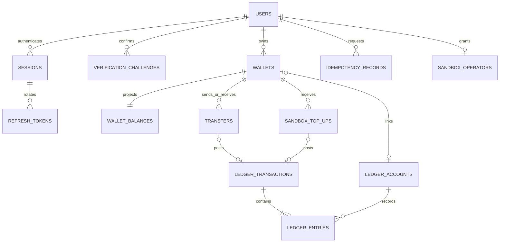

# Модель данных FinCore

Срез реализации: **15 ноября 2026**, миграции до `20261115_06`. Источник истины — [SQLAlchemy models](../backend/src/backend/infrastructure/db/sqlalchemy/models/) и [Alembic migrations](../backend/migrations/versions/). [PRD MVP v1.0](../FinCore_PRD_MVP_v1.0%20%281%29.pdf) — исторический baseline; текущая схема включает несколько кошельков одной валюты, verification, outbox и компактные receipts.

## Конвенции и связи

Идентификаторы сущностей — UUID, обычно v4. Все mapped `datetime` используют `TIMESTAMP WITH TIME ZONE`, приложение работает с timezone-aware значениями UTC. Деньги — BIGINT minor units выбранной валюты, без float; положительная сумма операции ограничена signed BIGINT, баланс неотрицательный. Валюты: USD, EUR, JPY, CHF, GBP, UZS, CAD, RUB. Статусы в БД — строки в нижнем регистре.

`outbox_messages` и `idempotency_receipts` не имеют FK к пользователю или polymorphic operation. Journal связан ровно с одним источником: transfer XOR sandbox top-up. Для проведённой операции обязателен один journal с согласованной парой проводок; это проверяют ограничения и deferred triggers, а не только ERD.

## Пользователи, сессии и подтверждения

| Таблица                   | Основные поля и ограничения                                                                                                                                                              |
| ------------------------- | ---------------------------------------------------------------------------------------------------------------------------------------------------------------------------------------- |
| `users`                   | UUID PK; уникальные индексированные `username` VARCHAR(256) и `email` VARCHAR(512); nullable `password_hash` TEXT; `status`; `created_at`, `updated_at`, nullable `last_login_at`        |
| `sessions`                | UUID PK; индексированный FK `user_id`; `expires_at`, nullable `revoked_at`; исходные `ip_address`/`user_agent`, последние `last_ip_address`/`last_user_agent`/`last_used_at`; timestamps |
| `refresh_tokens`          | UUID PK; индексированный FK `session_id`; уникальный `token_hash`; `expires_at`, nullable `used_at`, `replaced_by_id`; composite FK запрещает replacement в другой сессии                |
| `verification_challenges` | UUID PK; индексированный FK `user_id`; `purpose` registration/password_reset; уникальный `token_hash`; `expires_at`, nullable `used_at`                                                  |
| `sandbox_operators`       | `user_id` PK/FK users; отдельное серверное разрешение на sandbox funding                                                                                                                 |

User проходит `pending_confirmation → active`; также существуют `suspended` и `closed`. До подтверждения пароль может отсутствовать. Argon2id hash и hashes refresh/verification сохраняются вместо сырых секретов. История refresh rotation сохраняется целиком до удаления завершённой сессии, чтобы обнаруживать reuse.

Resend регистрации под блокировкой пользователя помечает прежние неиспользованные challenges использованными и атомарно создаёт новый challenge и outbox message. Подтверждения не удаляют финансовую историю или пользователя при истечении TTL.

## Кошельки и проекция

| Таблица           | Основные поля и ограничения                                                                                                                                              |
| ----------------- | ------------------------------------------------------------------------------------------------------------------------------------------------------------------------ |
| `wallets`         | UUID PK; FK/index `user_id`; `name` 1–64 после trim; уникальный `number` ровно 20 ASCII-цифр; `currency`; `status` active/frozen/closed; timestamps; UNIQUE(id,currency) |
| `wallet_balances` | `wallet_id` PK/FK; `posted_minor` BIGINT ≥0 DEFAULT0; `version` BIGINT ≥0 DEFAULT0; `created_at`, `updated_at`                                                           |
| `ledger_accounts` | UUID PK; уникальный `code`; nullable уникальный `wallet_id`; `account_type`, `currency`, `status`, `created_at`; composite FK(wallet_id,currency)                        |

Ограничения UNIQUE(user_id,currency) нет: пользователь может создавать несколько кошельков одной валюты. Номер хранится строкой, ведущие нули значимы. Цвет карты в UI не является полем текущей таблицы.

Wallet, нулевой balance и liability account создаются одной транзакцией. Счёт кошелька имеет code `WALLET:<uuid>:<currency>`, тип liability. Системный funding account не имеет wallet_id, имеет тип asset и code `SYS:SIM_FUNDING:<currency>`. Account status — active/closed; frozen wallet сохраняет активный account, но новые денежные операции запрещены application-проверкой под блокировкой.

`available_minor` не хранится и равен posted. `spendable_minor` вычисляется reader-ом с учётом wallet status. Баланс обновляется синхронно с journal; изменение проекции без проводок не является корректной денежной операцией. Идентичность кошелька и ledger account защищена UPDATE triggers.

## Операции и ledger

| Таблица               | Основные поля и ограничения                                                                                                                                                                                |
| --------------------- | ---------------------------------------------------------------------------------------------------------------------------------------------------------------------------------------------------------- |
| `transfers`           | UUID PK; sender/receiver wallet IDs с индексами и валютными FK; положительный amount BIGINT; currency; terminal status completed/rejected; timestamps, completed_at/rejection_code; разные sender/receiver |
| `sandbox_top_ups`     | UUID PK; wallet ID и currency с composite FK; FK `initiated_by_user_id`; положительный amount; terminal status и согласованные timestamps/rejection_code                                                   |
| `ledger_transactions` | UUID PK; kind p2p_transfer/sandbox_topup; currency; posted_at с индексом; nullable reference; уникальные transfer_id/sandbox_top_up_id и XOR источников                                                    |
| `ledger_entries`      | UUID PK; индексированные journal/account IDs; composite currency FKs; side debit/credit; amount BIGINT >0; created_at; UNIQUE(journal,account,side)                                                        |

Application сейчас сохраняет успешные операции completed. Бизнес-отклонение откатывает транзакцию; наличие rejected в модели не означает отдельное сохранение каждой отклонённой HTTP-команды.

Deferred guards требуют две проводки, равные суммы debit/credit, правильные счета, сумму/валюту/время и completed источник. Проведённые transfers, top-ups, journals и entries защищены от UPDATE/DELETE/TRUNCATE. Корректировка исторической операции не выполняется редактированием её строк. Reconciliation читает согласованный snapshot и сравнивает операции, journals и balance projections.

## Идемпотентность и постоянные receipts

`idempotency_records` содержит UUID PK, FK user_id, scope VARCHAR(80), клиентский key VARCHAR(255), payload_hash SHA256 hex, resource_id, created_at и expires_at. UNIQUE(user_id,scope,key) сериализует конкурирующие команды. Expires_at не раньше created_at+24h; завершённый результат и идентичность неизменяемы. Deferred guard проверяет соответствие результата пользователю, виду операции и постоянному receipt, если он уже существует.

`idempotency_receipts` содержит key_digest VARCHAR(64) PK, payload_hash VARCHAR(64), resource_id UUID и archived_at. Digest вычисляется из однозначного JSON-массива `[user_id,scope,key]` через SHA256. Receipt не хранит исходный ключ и user_id отдельными полями, не имеет TTL и защищён от UPDATE/DELETE/TRUNCATE.

Maintenance под блокировкой записи атомарно создаёт/проверяет receipt и удаляет старый полный record. DELETE guard дополнительно требует истечения expires_at и совпадающего receipt. Repository проверяет receipt после INSERT/conflict wait; поздняя команда получает прежний resource_id либо конфликт payload. Receipt не удаляет и не заменяет саму финансовую операцию.

Миграция06 запрещает downgrade при наличии receipts; проверка выполняется под блокировками records и receipts, исключающими конкурентное архивирование. Подробности хранения и безопасного развёртывания — в [maintenance](maintenance.md).

## Outbox и индексы очистки

`outbox_messages` хранит UUID PK, message_type, JSONB payload, status, attempts, next_attempt_at, lease (`locked_until`, `lock_token`), created_at/completed_at и безопасный last_error code. Статусы: pending/processing/sent/failed/expired. Payload существует только у pending/processing; processing требует lease. Partial indexes обслуживают очередь pending и истёкшие leases. Raw confirmation token временно присутствует в payload для доставки, затем payload очищается при terminal status.

Миграция06 добавляет индексы `(expires_at,id)` для sessions, verification_challenges и idempotency_records, `(revoked_at,id)` для sessions и partial `(completed_at,id)` для terminal outbox. Они поддерживают периодическую batch-очистку с `SKIP LOCKED`. Цепочки refresh удаляются одним DELETE перед удалением session; активные сессии, обрабатываемая очередь, ledger и receipts сохраняются.

Redis rate-limit keys имеют TTL и не входят в схему PostgreSQL. Отдельная таблица audit_log текущими моделями не реализована; JSON request logging не является финансовым append-only audit store.
